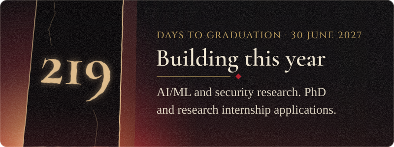
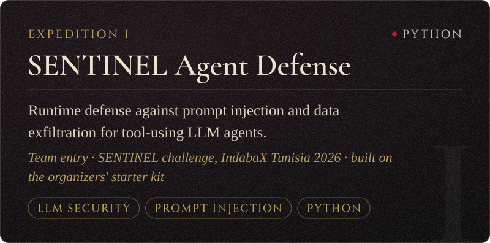
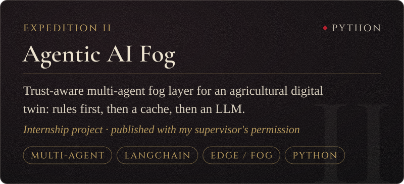
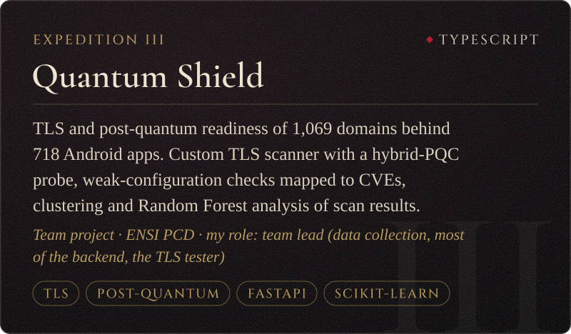
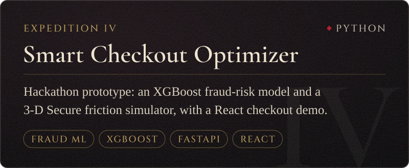
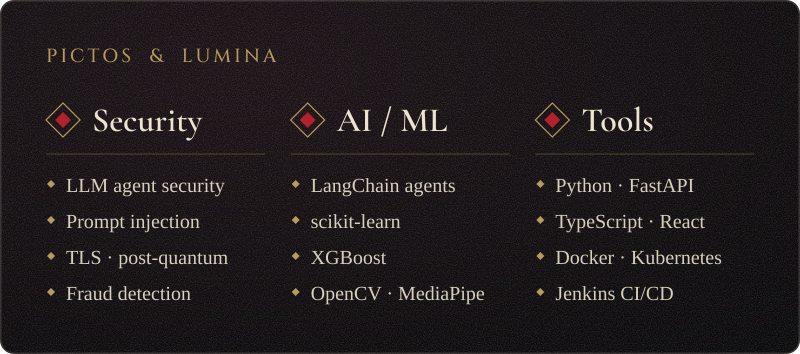
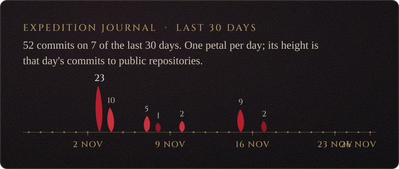

**Amine Essid** — final-year software engineering and security student at ENSI, working on AI/ML and cybersecurity: the security of LLM agents, and TLS and post-quantum cryptography in mobile ecosystems.
Applying for PhD positions and research internships.

## I · Expedition Log — selected projects

## II · Pictos and Lumina — skills

## III · Expedition Journal — recent activity

  <a href="https://github.com/Daehkcarc-sys?tab=repositories">Repositories</a>
  <!-- Add your contact links here, for example:
  · <a href="mailto:you@example.com">Email</a>
  · <a href="https://www.linkedin.com/in/your-handle">LinkedIn</a>
  · <a href="https://scholar.google.com/citations?user=your-id">Scholar</a>
  -->

Continuer à t'aimer

